<div align="center">

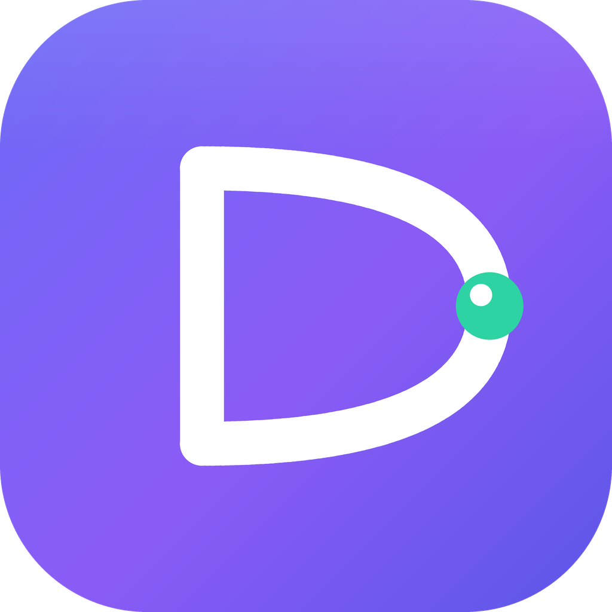

# دارام · DARAM

**پولت رو بشناس، هوشمندانه زندگی کن.**
*Know Your Money. Own Your Future.*

An AI-first, Persian-first, local-first personal finance assistant for Iranian users.
Built with Flutter · Drift/SQLite · Riverpod · your own AI provider.

</div>

---

## 1. What DARAM is

Traditional finance apps ask people to fill forms, one transaction at a time. DARAM starts from the other end: a conversation.

```
کاربر: امروز ۲۵۰ هزار تومن ناهار خوردم.
دارام: ۲۵۰,۰۰۰ تومان هزینه ناهار آماده شد. تأیید می‌کنی؟
        [ کارت پیش‌نویس: مبلغ، حساب، دسته‌بندی، تاریخ — قابل ویرایش ]
```

The model never writes to the database. It proposes a **structured financial draft** through strict JSON tools. DARAM validates the arguments, shows an editable confirmation card, and only commits after the user explicitly approves. Every write is journaled and can be undone.

**The core promise:** managing money should be as easy as talking about it.

## Screens (rendered from the app)

| | |
|---|---|
| 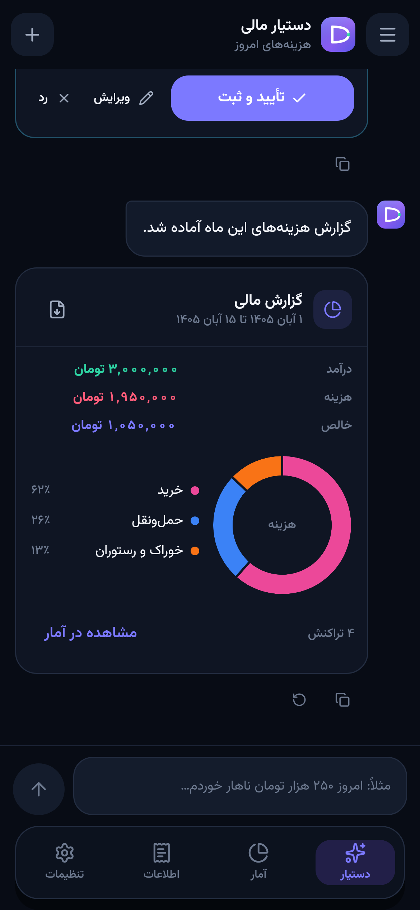 | 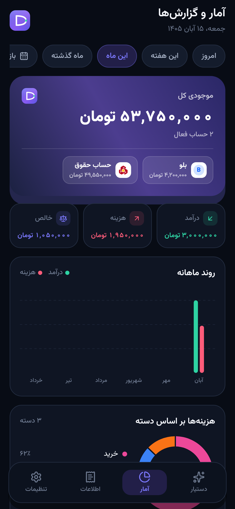 |
| **Chat** — drafts, reports and confirmations live in the conversation. | **Dashboard** — balance, cash flow and trends from the local ledger. |
| 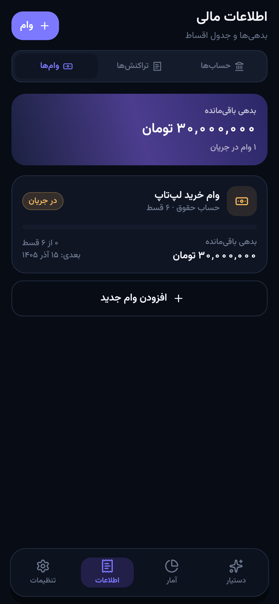 | 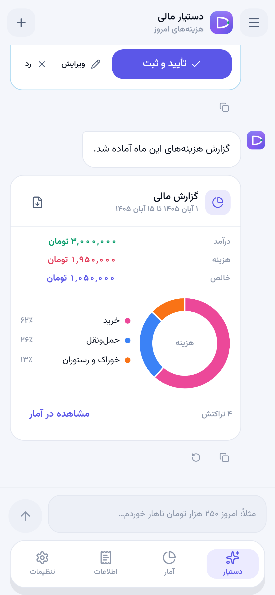 |
| **Loans** — outstanding balance, progress and installment schedule. | **Light theme** — independently designed, not an inversion. |
| 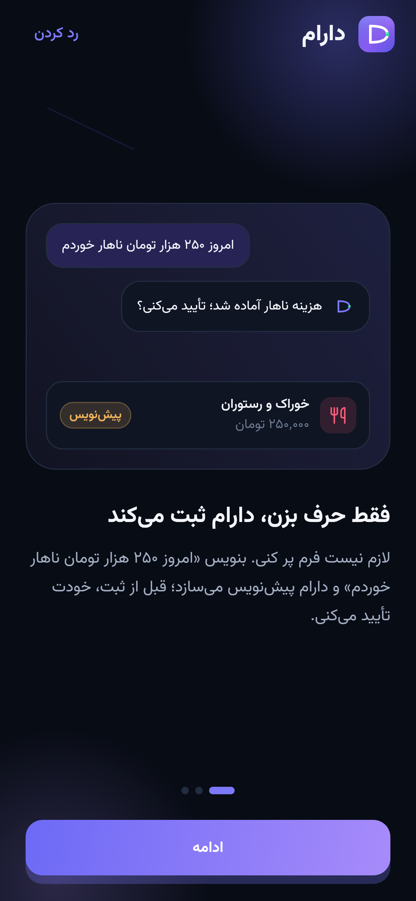 | 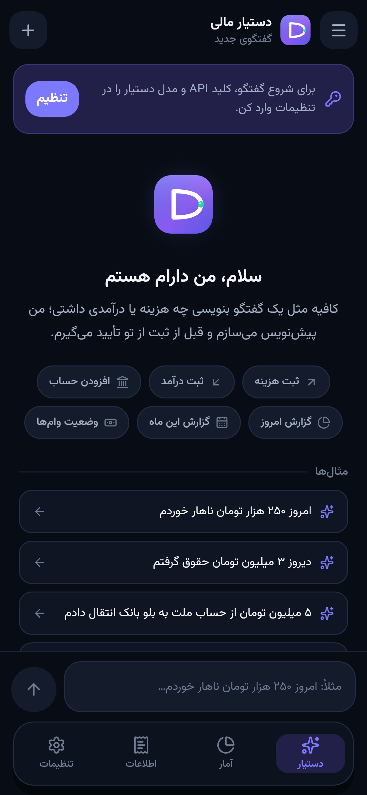 |
| **Onboarding** — three acts: talk, privacy, your own provider. | **Empty chat** — quick actions and example sentences. |
| 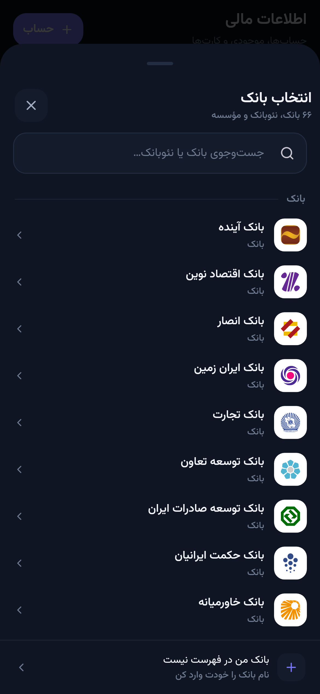 | 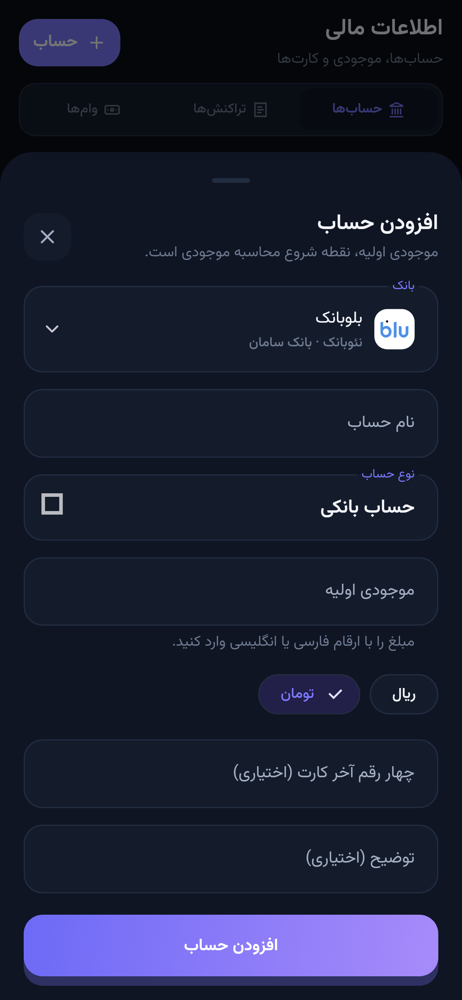 |
| **Bank catalog** — 40 banks and 26 neobanks, searchable, with bundled bank marks. | **Account editor** — BluBank selected; logos and neobank parent are shown. |
| 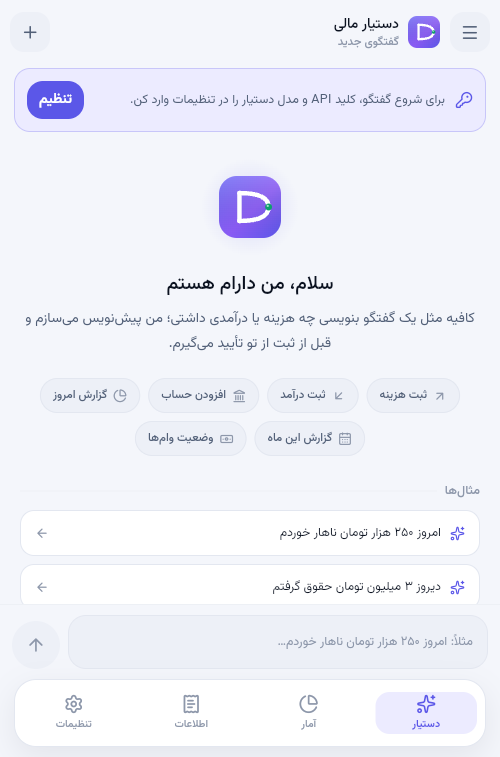 | 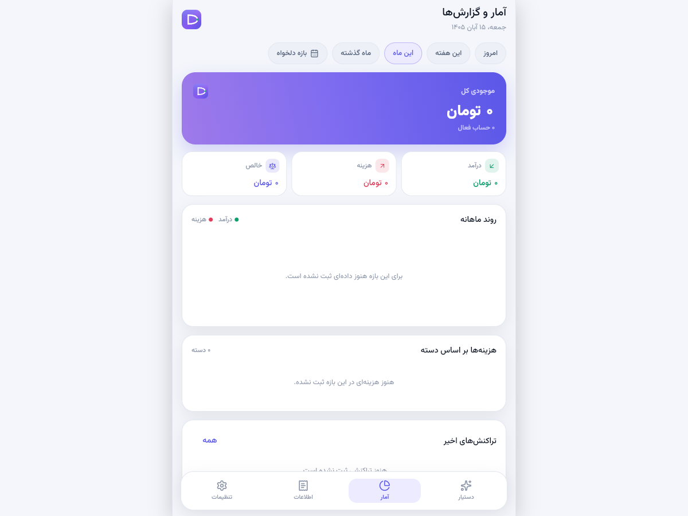 |
| **Web — chat** — the same app running in Chrome, with local WASM storage. | **Web — desktop** — wide windows use a centered 600 px frame. |

## 2. Phase 1 scope (what works today)

- **Chat-first experience** — multiple conversations, history, search, rename, delete, Markdown, RTL, streaming, typing indicator, stop/retry/regenerate, copy.
- **AI provider of your choice** — OpenAI-compatible endpoints, native Anthropic, native Gemini, strict JSON fallback for models without tool calling. API key stored in `flutter_secure_storage`.
- **Structured tools** — `add_account`, `add_transaction`, `add_transfer`, `add_loan`, `mark_installment_paid`, `query_transactions`, `generate_report`, each with a JSON Schema asset.
- **Financial safety workflow** — pending drafts, per-field editing, individual or batch confirmation, idempotent operation ids, undo.
- **Persian understanding** — Persian/Arabic/English digits, colloquial amounts («۲۵۰ هزار», «یک و نیم میلیون», «سه میلیون»), Jalali and relative dates, transfer detection, multi-activity messages, loans and installments.
- **Local ledger** — integer Rial amounts, a single `ledger_entries` table as the source of truth for balances, atomic transfers, deterministic loan schedules.
- **Dashboard** — total balance, account balances, income/expense/net, monthly chart, category donut, recent activity, upcoming installments.
- **Records** — accounts (archive/edit), transactions (filter, search, create, edit, delete), transfers, loans with installment schedule and payments.
- **Settings** — light/dark/system themes, Toman/Rial display, Persian digits, categories CRUD, CSV/PDF exports, full JSON backup/restore, and the live version name/build code (via `package_info_plus`) in About ([screenshot](docs/screenshots/about-version-light.png)).
- **Searchable Iranian bank catalog** — 40 banks/credit institutions and 26 neobanks, each mapped to a real bundled mark; digital banks without a standalone mark use their parent bank's logo, and a custom-bank fallback covers anything else.
- **No network dependency for core use** — the app opens, reads and writes locally without an AI connection.

## 3. Quick start

### Requirements

| Tool | Version used and verified |
|---|---|
| Flutter | **3.47.7** (stable) |
| Dart | **3.13.5** |
| Android SDK | compileSdk/targetSdk from Flutter; minSdk **24** |
| Java (Android build) | **JDK 21** |
| Linux desktop | CMake, Ninja, Clang, GTK 3, libsecret (details in the platforms doc) |
| Web | Chrome for `flutter run -d chrome`; any static host for the build |

### Supported platforms

| Platform | Status |
|---|---|
| Android | **verified** — debug APK built and inspected |
| iOS | project configured; not built here (no macOS/Xcode) |
| Linux | **verified** — debug/release builds; startup and database smoke-tested |
| Web | **verified** — release build driven in Chrome; WASM database initialized |

Prerequisites, build commands and the web/Linux caveats are in
[`docs/PLATFORMS.md`](docs/PLATFORMS.md).

### Install and run

```bash
flutter pub get
dart run build_runner build        # Drift code generation
flutter run                        # on a connected Android device/emulator
flutter run -d linux               # Linux desktop
flutter run -d chrome              # web (development)
```

> The repository already contains the generated Drift code (`lib/data/database/app_database.g.dart`), so `build_runner` is only needed after changing tables.

### Verify

```bash
dart format --output=none --set-exit-if-changed .
flutter analyze
flutter test
```

## 4. Configuring the AI assistant (BYOK)

Open **تنظیمات → دستیار هوشمند** and fill in:

| Field | Examples |
|---|---|
| Provider | OpenAI-compatible / Anthropic / Gemini / **OpenCode** / **OpenCode Go** |
| Base URL | `https://api.openai.com/v1`, `https://openrouter.ai/api/v1`, `https://api.anthropic.com`, `https://generativelanguage.googleapis.com`, `https://opencode.ai/inference/openai/v1`, `https://opencode.ai/inference/go/openai/v1` |
| Model | `gpt-4o-mini`, `claude-sonnet-4-5`, `gemini-2.5-flash`, `glm-5.3` (OpenCode), `kimi-k3` (Go), or use the live catalog button |
| API Key | your own key; OpenCode keys start with `oc_sk_` |
| Tool mode | native function calling, or strict JSON for models without tools |
| Timeout | 30–180 seconds |

Press **تست اتصال** to perform a real minimal completion. The status is shown inline in Persian.

**OpenCode / OpenCode Go** ask only for the API key: the vendor's endpoint is applied automatically, and the model selector reads the live catalog (the provider default is used until you change it). The API key is stored per provider, so switching providers asks for that provider's own key instead of reusing the previous one.

Notes:

- **The key never leaves secure storage.** It is not written to preferences, logs, backups, or the database. Keys are scoped per provider.
- Requests go **only** to the endpoint you configure. There is no DARAM backend, no telemetry, no Firebase, no Google services.
- Only the minimum context is sent per request: system prompt, recent conversation, account names/balances, categories and loan summaries. The full database is never uploaded.
- Android blocks cleartext HTTP by default. Use an HTTPS endpoint (a local HTTPS proxy works).
- If the provider does not support tool calling, choose **JSON** mode. Responses are validated; malformed JSON is retried once and then surfaced as a clear error.
- **OpenCode / OpenCode Go:** create an `oc_sk_...` key in [OpenCode Console](https://opencode.ai/console) (**Account → Personal API keys**). OpenCode draws from Console credit; Go requires a Go, Go Plus or Go Teams subscription. The model selector reads the live catalog (`/inference/v1/models` or `/inference/go/v1/models`) and flags models without native tool support. DARAM sends the documented `x-opencode-session` header and a stable user agent; Go is intended for coding-agent traffic, and model/region availability and per-model data retention are set by OpenCode.
- **Diagnostics:** **تنظیمات → گزارش‌های دستیار** keeps the last 250 assistant events on the device (provider, model, status code, latency, network error type and a short server message). API keys, request headers and the full conversation are never logged. Tap a row to expand the technical detail, copy the list, or clear it. This is the first place to look when the assistant returns an empty answer or times out.

## 5. Privacy model

1. **Local-only financial data.** SQLite on the device. No account, no registration, no cloud sync, no analytics SDK.
2. **AI is optional.** Without a configured provider you can still use every local feature: accounts, transactions, transfers, loans, reports, exports and backups.
3. **Optional SMS access on Android.** DARAM reads the inbox on-device after permission. The optional SMS AI switch sends masked financial templates from linked senders and relevant receipt context to the configured provider. OTPs and raw inbox messages stay on the device. When you ask the assistant to review SMS suggestions, only the parsed fields (amount, type, account, category, date, description and sender) are sent for that conversation — never the raw SMS body.
4. **Explicit consent before writes.** A draft is never a record. Confirmation is always a separate, user-initiated action.
5. **Auditability.** Every committed operation is recorded in `financial_operations`; safe operations can be reversed.

## 6. Architecture

Feature-first clean architecture. The presentation layer never touches Drift; the AI layer never touches financial tables.

```
lib/
  main.dart                     bootstrap: DB, preferences, secure storage
  app/
    app.dart                    MaterialApp.router, RTL, themes, format scope
    app_providers.dart          Riverpod graph (repositories, AI, services)
    router/app_router.dart      go_router + StatefulShellRoute
    app_shell.dart              floating four-tab navigation
    theme/                      DaramColors, DaramTheme, tokens
    design_system/              cards, inputs, chips, Jalali picker, amounts
    branding/                   DaramMark painter, logo lockup, aura
  core/
    money/                      Rial value object, display units
    formatting/                 Persian digits, MoneyFormatter
    persian/                    Deterministic amount parser
    time/                       CalendarDate, Jalali text/picker, date parser, presets
    domain/                     Shared enums
    errors/                     Persian-facing exceptions
    constants/                  Banks, default categories, app info
    services/                   Secure key store
  data/database/
    app_database.dart           Drift schema + migration strategy
    tables/                     Financial and chat tables
    mappers.dart                Row → domain entity
  features/
    ai/                         provider abstraction, OpenAI/Anthropic/Gemini,
                                SSE, tool registry, schema validator, executor,
                                prompt builder, conversation loop
    chat/                       chat repository, controller, UI, draft editing,
                                confirmation/undo services
    accounts/ transactions/     data + domain + presentation
    loans/ dashboard/ settings/ categories/
```

### The write path (most important invariant)

```
user message
   → AI provider streams text / tool calls
   → ToolExecutor validates JSON Schema + domain (account exists, category type,
     positive integer Rial, valid date, deterministic installments)
   → PendingAction (status=pending, unique operationId)   [no financial write]
   → editable card in chat
   → ConfirmationService.confirm(actionId[, edited payload])
   → repository validates again
   → Drift transaction: source row + ledger entries + operation journal
   → success message with undo
```

- All writes are **idempotent** by `operationId` (`financial_operations` is also the journal).
- Confirmation cannot run twice: pending status is checked and transitions atomically.
- A failed confirmation leaves the draft editable and shows the Persian validation error.

### Ledger and balances

Balances are never stored as a mutable column. `ledger_entries` records one row per movement (`transaction`, `transferOut`, `transferIn`, `loanDisbursement`, `installmentPayment`); an account balance is:

```
initial_balance_rial + SUM(ledger_entries.delta_rial)
```

Transfers write both legs and (optionally) a separate expense record for the fee in one SQLite transaction. Loans credit the principal to the account but are **not** income. Installments debit the account only when paid.

### Money rules

- **All money is integer Rial.** 1 Toman = 10 Rial.
- A single `Rial` value object rejects overflow and negative-forbidden operations.
- Formatting never mutates the stored value: 1,000,000 Rial is `۱,۰۰۰,۰۰۰ ریال` or `۱۰۰,۰۰۰ تومان`.
- A 5-rial remainder displays as `۰٫۵ تومان` instead of being silently rounded.
- Loan division uses integer division; the remainder goes to the **last** installment and the schedule is visible to the user.

### Date rules

- `CalendarDate` stores a day as **UTC midnight**; the stored value never shifts with the device timezone.
- Presentation and pickers use the Jalali calendar (`shamsi_date`).
- The AI receives today's Gregorian date, Jalali date, weekday, time and offset on every request.
- Persian relative dates are parsed deterministically (`PersianDateParser`) and missing years are flagged on the draft, not silently guessed.

## 7. Database schema (v1)

| Table | Purpose | Key columns |
|---|---|---|
| `accounts` | user-owned accounts | `id`, `bank_id`, `account_type`, `initial_balance_rial`, `archived_at` |
| `categories` | editable income/expense categories | `id`, `name`, `type`, `icon`, `color_hex`, `is_default` |
| `transactions` | income/expense records | `amount_rial`, `category_id`, `account_id`, `transaction_date`, `operation_id` (unique) |
| `transfers` | account-to-account movements | `source_account_id`, `destination_account_id`, `fee_rial`, `operation_id` |
| `ledger_entries` | single source of truth for balances | `account_id`, `delta_rial`, `source_type`, `source_id`, `operation_id` |
| `loans` | loans and liability | `principal_amount_rial`, `interest_amount_rial`, `installment_count`, `status` |
| `installments` | deterministic schedule | `due_date`, `amount_rial`, `principal_rial`, `interest_rial`, `status`, `paid_amount_rial` |
| `chat_sessions` | conversations | `title`, `created_at`, `updated_at` |
| `chat_messages` | messages + metadata JSON | `role`, `message_type`, `metadata_json` |
| `pending_actions` | financial drafts | `action_type`, `payload_json`, `status`, `operation_id` (unique) |
| `financial_operations` | audit + undo journal | `kind`, `entity_id`, `payload_json`, `status`, `undone_at` |

Foreign keys are enabled (`PRAGMA foreign_keys = ON`), indexes cover dates, accounts, categories, sessions and ledger lookups. `schemaVersion` is 1; future changes belong in a numbered migration.

## 8. AI integration

- **One abstraction:** `AIProvider.streamChat(...)` emits text deltas, assembled tool calls, done and Persian errors. Provider code is isolated from chat and finance.
- **OpenAI-compatible:** `/v1/chat/completions`, SSE, native `tools`, custom base URL/model, configurable timeout.
- **Anthropic:** native Messages API, `tool_use`/`tool_result` blocks, SSE.
- **Gemini:** `streamGenerateContent?alt=sse`, function declarations, OpenAPI-style schema conversion.
- **JSON fallback:** one valid JSON envelope per response, parsed defensively, one corrective retry, never executed when malformed.
- **Tool loop:** up to three model↔tool rounds per user turn, so the assistant can ask a question after a validation error.
- **Prompts:** `assets/ai/system_prompt_fa.md` + five few-shot files + seven tool schemas. Dynamic context is injected per request.
- **Nothing is fabricated:** if a read tool is needed, it is executed against the local DB; the model only interprets the returned numbers.

## 9. Design system

- **DARAM mark:** a geometric D with a mint node on its shoulder; works from 24 px to launcher size. Painted in Dart; the source art and adaptive layers are generated by `tool/generate_icon.py`, and all platform launcher icons are generated by `flutter_launcher_icons`.
- **Type:** Vazirmatn (Light→ExtraBold), bundled locally, tabular figures for amounts.
- **Palette:** ink-indigo dark (`#080C15`), soft light (`#F4F6FB`), indigo accent, mint income, rose expense, cyan transfer, amber warning. Both themes are independently designed, not inverted.
- **Tokens:** `ThemeExtension<DaramColors>` plus spacing/radius constants; cards, gradients, shadows and charts share them.
- **Components:** `DaramCard`, `AmountText`, `PrimaryButton`, `DaramChip`, `BankAvatar`, `CategoryAvatar`, `JalaliDateField`, custom Jalali date picker, floating nav bar.
- **Accessibility:** RTL everywhere, semantic labels on navigation, 48 px touch targets, WCAG-conscious contrast, text scaling-friendly layout.
- **Motion:** `flutter_animate` for splash/onboarding/chat entry, animated charts, a custom typing indicator, press scale feedback. No motion on financial data itself.

## 10. Assets and licenses

| Asset | Source | License |
|---|---|---|
| Vazirmatn fonts | [rastikerdar/vazirmatn](https://github.com/rastikerdar/vazirmatn) v33.003 | SIL OFL 1.1 (`assets/fonts/OFL.txt`) |
| Iranian bank logos (40) | [zegond/logos-per-banks](https://github.com/zegond/logos-per-banks) | CC0 1.0 (`assets/banks/LICENSE.txt`) |
| BluBank logo | [Wikimedia Commons](https://commons.wikimedia.org/wiki/File:Blubank_light_logo.svg) | CC BY-SA 4.0 (`assets/banks/ATTRIBUTION.md`) |
| Official neobank marks | Bankino, Banket, HiBank, OmidBank, GreenBank, ForBix | Trademarks; identification only (`assets/banks/ATTRIBUTION.md`) |
| SQLite WASM | [sqlite3.dart 3.9.0](https://github.com/simolus3/sqlite3.dart/releases/tag/sqlite3-3.9.0) | MIT / SQLite public domain |
| drift web worker | compiled from `tool/drift_worker.dart` | drift MIT |
| PWA icons | generated by `flutter_launcher_icons` from `app_icon_1024.png` | project identity |
| Icons | Lucide via `lucide_icons_flutter` | ISC |
| DARAM mark, icon, splash, UI | original, created for this project | project identity |
| Prompt and few-shot examples | original, written for this project | project content |

Fifteen digital banks have a standalone mark (seven official marks plus eight public brand marks); the other 11 use their parent bank's logo, shown with the parent in the picker. There are no generated letter placeholders. Logos are used for identification only. See [`docs/ASSETS.md`](docs/ASSETS.md) and [`assets/banks/ATTRIBUTION.md`](assets/banks/ATTRIBUTION.md).

## 11. Testing

```bash
flutter test                       # all unit, widget and integration tests
flutter test test/unit              # money, dates, repositories, tools, AI loop, exports
flutter test test/widget            # boot, onboarding, chat confirm, navigation, theme
flutter test test/integration       # Scenario B through the real chat pipeline with a fake provider
```

Coverage highlights:

- Money conversion, overflow, formatting, no silent rounding.
- Persian amount parsing (digits, words, fractions, scales, colloquial units).
- Jalali/Gregorian conversion, relative date parser, date ranges.
- Ledger consistency, idempotency, transfers (fee), loan schedules, installments, analytics.
- Tool schemas, validation, executor drafts, confirmation, undo, backup round-trip, CSV/PDF output.
- The full AI loop with a scripted fake provider: native tool calls, JSON envelope, malformed JSON retry, missing key.
- Widget: splash/onboarding/chat, draft confirmation writes to Drift, dashboard/records/settings rendering, dark mode, RTL.
- Integration: three activities in one message → three cards → **تأیید همه** → three records with correct balances.

**No real API key is required** for any test. The current suite is **90 tests** across the unit, widget and integration suites, including the 66-entry/55-mark bank catalog and the searchable bank picker.

## 12. Builds

### Release scripts (Android signing, web and Linux)

```bash
./scripts/release.sh          # interactive menu
./scripts/build-android.sh    # signed Android APK
./scripts/build-web.sh        # production web zip
./scripts/build-linux.sh      # production Linux tar.gz
```

The first Android release offers to generate a 4096-bit release keystore and
writes `android/key.properties` (both gitignored, chmod 600). The script passes
`-PrequireReleaseSigning=true`, so a production build cannot silently fall back
to the debug key. All artifacts are versioned in `dist/` with `SHA256SUMS`.
The full guide, CI example and key-backup rules are in
[`docs/RELEASING.md`](docs/RELEASING.md).

### Android

```bash
flutter build apk --debug
# output: build/app/outputs/flutter-apk/app-debug.apk
```

- `minSdk 24` (raised by plugin requirements), `applicationId ir.daram.daram`, label «دارام».
- `INTERNET` permission is declared in the main manifest (release builds need it for AI calls).
- Release builds: use `./scripts/build-android.sh` (or `./scripts/release.sh`). The first run creates the release key and `android/key.properties`; `flutter run --release` without a key still uses the debug key for local testing.
- Native launch screens are dark to avoid a white flash; the in-app splash is the animated brand screen.

### Linux

```bash
flutter build linux --release
./build/linux/x64/release/bundle/daram
```

The Linux build needs Clang, CMake, Ninja, GTK 3 and libsecret. The database is a
SQLite file in the app documents directory; the API key uses the desktop keyring
through libsecret, and export/import uses `zenity`. Full prerequisites and
diagnostics: [`docs/PLATFORMS.md`](docs/PLATFORMS.md).

### Web

```bash
flutter build web --release --no-web-resources-cdn
python3 -m http.server 8080 --directory build/web
# open http://localhost:8080
```

- `web/sqlite3.wasm` and `web/drift_worker.js` are required and committed. The
  worker is compiled from `tool/drift_worker.dart`; keep it in sync with the
  `sqlite3` version.
- CanvasKit is bundled locally (`--no-web-resources-cdn`), so rendering does not
  depend on Google's CDN.
- The app is installable as a PWA; data lives in the browser's IndexedDB (and
  OPFS when available).
- AI from the browser is subject to CORS, secure storage needs HTTPS or
  localhost, and responses are buffered rather than token-by-token. Details and
  workarounds: [`docs/PLATFORMS.md`](docs/PLATFORMS.md).

## 13. Package selection (summary)

| Area | Choice | Why |
|---|---|---|
| Database | `drift` + `drift_flutter` + `sqlite3` 3.x | typed queries, codegen, migrations, stream queries; `sqlite3_flutter_libs` is EOL and drift 2.35 uses sqlite3 3.x native assets |
| State/DI | `flutter_riverpod` 3 | compile-safe providers, easy test overrides, no BuildContext dependency in controllers |
| Routing | `go_router` 18 | stateful bottom-navigation branches + deep links |
| Networking | `dio` | streaming responses, cancel tokens, per-request timeouts |
| Secrets | `flutter_secure_storage` 11 | Keychain/Keystore, libsecret and WebCrypto-backed key storage |
| Jalali | `shamsi_date` + custom picker | maintained conversion; custom picker matches DARAM design |
| Charts | `fl_chart` 1.3 | bar/pie with animation and tooltips |
| Markdown | `flutter_markdown_plus` | maintained successor to the discontinued `flutter_markdown` |
| Icons | `lucide_icons_flutter` | actively maintained; the old `lucide_icons` has not shipped since 2023 |
| PDF | `pdf` + `arabic_reshaper` + `bidi` | PDF shaping is not provided by the renderer; shaping is applied explicitly |
| Files | `file_picker` 13 | save/pick local export and backup files |

`langchain_dart` was evaluated but not used: DARAM needs precise control over SSE framing, provider-specific tool blocks, cancellation and custom endpoints, and the app already has a thin, tested abstraction. Avoided: Firebase, Google Fonts runtime, runtime image URLs, heavy chat UI kits. Full rationale and versions are in [`docs/PACKAGES.md`](docs/PACKAGES.md).

## 14. Assumptions and known limitations

- **iOS is configured but was not built here** (no macOS/Xcode in the environment). Android, Linux and web are verified.
- **Web-specific limits:** browser AI calls are subject to provider CORS; token streaming is buffered; the API key needs HTTPS or localhost; browser storage is cleared with site data. Use the Android/Linux build when a provider blocks CORS.
- **Linux-specific limits:** saving the API key requires a running keyring (GNOME Keyring/KWallet); export/import needs `zenity` or `qarma`.
- **SMS review is Android-only.** In each account, open **انتخاب سرشماره‌ها** and select its senders from the inbox. New messages are checked while the app is running and caught up on reopen. Initial import can include the previous 30 days. Use **بازبینی پیامک‌ها** in chat or Settings, or ask the assistant in the chat itself: pending suggestions appear as one compact panel. Tap **پاسخ** on a row to write an instruction about that suggestion, or tap **انتخاب** and pick several rows for one group command. The assistant receives the exact suggestion ids and can confirm, edit or dismiss them; the manual confirm/edit/reject actions remain available from each row's details. Editing a draft is allowed while reviewing, but confirmation and rejection still require the suggestion to have been shown in that conversation. Edited drafts are marked and survive later inbox rescans. The optional AI switch learns unfamiliar templates with your configured provider.
- **AI quality depends on the chosen model.** Tool-calling models are strongly preferred; JSON mode is a fallback, not an equal experience.
- **Bank catalog:** names follow public Iranian banking/neobank lists and may lag regulatory mergers. Users can always add a custom bank or neobank. Fifteen digital banks have a bundled standalone mark; the remaining 11 reuse their parent bank's logo. All marks are trademarks used only for identification.
- **Transfers cannot be edited in place.** They can be deleted (with confirmation); fee rows are protected from direct edits.
- **Undo covers AI-confirmed operations** (transaction, transfer, loan, installment payment, empty account). It refuses when dependent records exist (e.g. an account with transactions). Manual edits/deletes are not journaled.
- **Loan model:** equal installments; remainder on the last; total interest split evenly; no amortization schedule or interest-rate calculation. Interest is tracked on the loan, not auto-booked as an expense.
- **Date ambiguity:** a missing year is resolved to the nearest past occurrence and flagged on the draft; a missing date is never invented.
- **Local backup is plaintext JSON** (by design, so it is portable). Users are warned to store it safely. SQLCipher/encrypted backup is Phase 2.
- **PDF Persian shaping** uses `arabic_reshaper` + `bidi`, draws shaped text in visual order, and lays the page/table out RTL with Persian digits. Free-text descriptions that mix Latin and Persian may still need a quick review.
- **Chat context** is trimmed to the last 24 messages, and read tools are limited (e.g. 100 transactions per call) to keep requests small.
- **Schema migrations** preserve existing chats and financial records when adding the SMS review tables.

## 15. Phase 2 roadmap

1. **Encryption at rest** (SQLCipher) and encrypted backups.
2. **Voice input** with on-device speech, then the same draft pipeline.
3. **Recurring transactions, budgets and goals**, with proactive but quiet insights.
4. **Cloud sync / multi-device** with end-to-end encryption and conflict-safe ledgers.
5. **Bank integrations** via licensed open-banking APIs, always user-consented.
6. **Smarter reports**: cash-flow forecast, category trends, subscription detection.
7. **Widgets / share sheet / shortcuts**, plus a full iOS release pipeline and Windows/macOS shells.

## 16. Project structure (top level)

```
android/ ios/ linux/ web/  native shells and the web/PWA shell
scripts/                   interactive release builder + target wrappers
assets/
  ai/                      Persian system prompt, tool schemas, few-shot examples
  fonts/                   Vazirmatn + OFL
  banks/                   CC0 bank logos, Blue CC BY-SA, official neobank marks, attribution
  images/                  generated app icons
lib/                       see architecture above
test/                      unit / widget / integration
tool/                      icon generator, drift web worker, environment wrappers
docs/                      packages, assets, platforms
web/sqlite3.wasm           SQLite WASM runtime (3.9.0)
web/drift_worker.js        compiled from tool/drift_worker.dart
```

## 17. Environment note

This build was made on a Linux machine whose Flutter SDK lives on a read-only mount. The Linux desktop engine artifact was downloaded once into the SDK cache with a wider one-off approval; everything else uses the wrappers below. Release tasks also update engine stamps in that cache, so they need write access on this setup; the release scripts use the direct-Gradle path automatically. To make commands reproducible without modifying the SDK, the repository contains:

- `.tool/flutter` and `.tool/dart` — thin wrappers that call the Flutter tool snapshot directly with a workspace `PUB_CACHE`.
- `.tool/flutter_gradle` — a writable copy of the Flutter Gradle plugin; `android/settings.gradle.kts` prefers it only when present.
- `.tool/flutter-sdk` — a symlinked view of the SDK with a working `bin/flutter`, used only by Gradle.
- `.tool/gradle-home` and `.tool/android-home` — writable Gradle/Android homes (the debug keystore lives there).
- `.tool/` is ignored by git.

Because `flutter build` rewrites `local.properties` to the real read-only SDK, the verified Android build in this environment was run directly:

```bash
cd android
JAVA_HOME=/usr/lib/jvm/java-21-openjdk \
ANDROID_HOME=$HOME/Android/Sdk \
ANDROID_USER_HOME=$PWD/../.tool/android-home \
GRADLE_USER_HOME=$PWD/../.tool/gradle-home \
./gradlew assembleDebug
# → build/app/outputs/flutter-apk/app-debug.apk (also verified via aapt2)
```

The web build was served locally and driven in headless Chrome through the DevTools protocol; the WASM database reported `sharedIndexedDb` and the chat/dashboard screens rendered without runtime exceptions. The Linux debug bundle was launched on the real X11 display with isolated `HOME`/`XDG` directories, opened `daram.sqlite`, and stayed running until the test timeout.

On a normal developer machine, ignore `.tool/` and use `flutter build apk --debug` as documented above.

---

<div align="center">

**دارام** — ساخته‌شده برای اینکه مدیریت پول، به اندازهٔ حرف زدن دربارهٔ آن ساده باشد.

</div>
